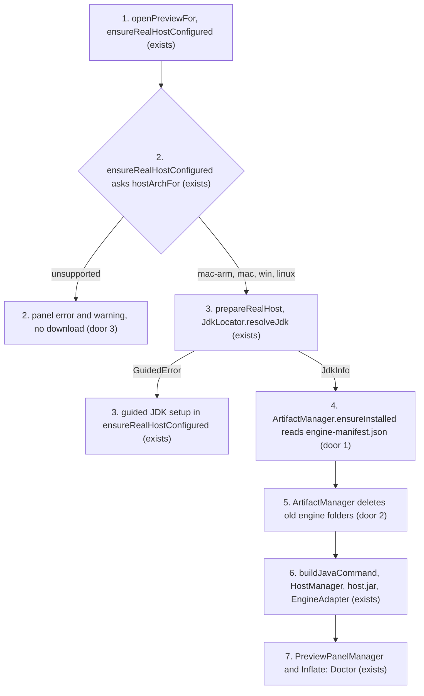
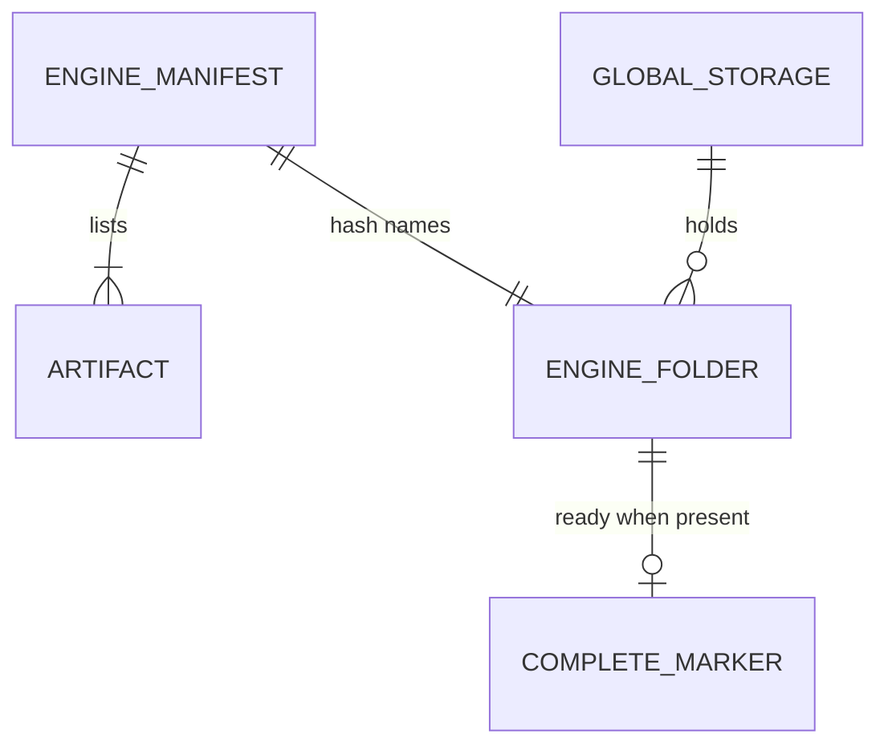
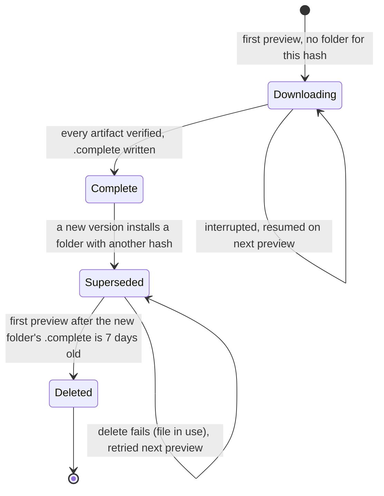

# Multi-platform support (Windows x64 and Linux x64)

**Approved**: 2026-11-21 - user: "Sure. Make it, approve the plan and commit it"

> Build this with **tlc-implement**. Every criterion becomes a check with a proof; nothing under
> the open questions is settled while building.

## Problem

On Windows and Linux, Inflate installs from the Marketplace (the VSIX is universal) but no preview
ever renders. `detectHostArch()` (`extension/src/activation.ts:388` on `main`) maps every process
that is not arm64 to the Intel Mac classifier, so the first preview downloads about 170 MB,
including `layoutlib-runtime-14.0.11-mac.jar`, whose macOS natives Windows and Linux cannot load,
and layoutlib stops with `Failed to init Bridge`. The user pays the download and gets an error that
does not say why. The store page mentions "macOS-only" in one line (`extension/README.md:23`) and
nothing stops the install. The .NET Android audience, which works mostly on Windows, is the one
AD-004 knowingly left out.

Evidence:

- GitHub issue #7 (Windows user, 2026-10-10), title `Failed to init Bridge`, comment: "it should
  download the Windows layoutlib, not the Mac one. (layoutlib-runtime-14.0.11-win.jar 71.7MB)".
- CI run 44854949195 (2026-11-21, branch `feature/multi-platform-support`): with the right natives
  selected, `windows-2025` and `ubuntu-26.04` render all 42 existing goldens at 0.000%; a custom
  `@font/` renders on all three systems; on Windows the engine fetch, engineTest and corpus pass
  with the longest engine file at 280 characters.
- Google publishes `layoutlib-runtime` natives as `mac-arm`, `mac`, `win` and `linux` only; the
  Windows DLLs are x64 (PE machine `0x8664`); `win-arm64` and `linux-arm64` return 404 up to
  layoutlib 17.0.4.

When this ships: a Windows x64 or Linux x64 user opens a preview and sees the same image a macOS
user sees, and a Windows or Linux user on Arm reads why it cannot work before anything downloads.

## Shape

This reuses the existing engine pipeline (bundled manifest, `ArtifactManager`, render host,
preview panel) and the existing CI pipeline on two more pinned runners; there is no second
rendering path. The rules that decide the outcome (platform to classifier, JDK search order, which
engine folders get deleted) run in `hostArchFor`, `JdkLocator` and `ArtifactManager` (vitest, run
on all three runners) and in the host's `EngineArtifacts` (JUnit); the corpus, the integration
suite and the clean-profile smoke prove them end to end on each runner.

1. `Inflate: Open Preview` -> `activation.ts` `openPreviewFor` (exists) -> `ensureRealHostConfigured` (exists)
2. `ensureRealHostConfigured` (exists, changes) asks `hostArchFor(platform, arch)` (exists, changes) with the pair on `InflateApi.platform` (`process.platform`, `process.arch`), before the fake-host shortcut and before `prepareRealHost`: `mac-arm`, `mac`, `win`, `linux`, or unsupported. Unsupported: error in the panel and a warning notification with no buttons, then stop (door 3); supported: `prepareRealHost` (exists) receives the classifier
3. `JdkLocator.resolveJdk` (exists, changes) walks the source list of the running OS and returns `JdkInfo` (`javaBin` is `bin\java.exe` on Windows) or the existing `GuidedError`
4. `ArtifactManager.ensureInstalled` (exists) reads `engine-manifest.json` (exists, four runtime classifiers, door 1), keeps the one runtime for the platform, downloads, verifies SHA-256, unzips into `globalStorage/engine/<manifestHash>/`, runs the two generator JVMs hidden, writes `.complete`
5. `ArtifactManager` (exists) deletes the other `globalStorage/engine/*` folders last written before the current `.complete`, once that `.complete` is at least 7 days old, best effort (door 2)
6. `buildJavaCommand` + `HostManager` (exists) spawn the packaged `host.jar` (exists, keeps JNA's Windows bindings) with no console window; `EngineAdapter` (exists) loads `data/<classifier>/lib64` through Paparazzi
7. out: the PNG in the preview panel via `PreviewPanelManager` (exists); `Inflate: Doctor` (exists) prints the platform



**Changes underneath**

| Front | What changes |
| --- | --- |
| domain | `HostArch` meant a macOS CPU (`mac-arm`, `mac`); it now names OS plus CPU (`mac-arm`, `mac`, `win`, `linux`) and `hostArchFor` can answer unsupported. Readers: `selectRelevantArtifacts`, `ensureRealHostConfigured`, `Inflate: Doctor`, `Inflate: Clear Engine Cache`, `smoke.ts`; `ArtifactManager` takes `undefined` on an unsupported platform (reports and clears, refuses to install). Already on the branch: `bca9b70` maps `win32` to `win` for every CPU, which criterion 1 changes |
| domain | `JdkSource` gains the Windows and Linux sources; reader: Doctor's `source:` line |
| stored data | `globalStorage/engine/<hash>` gets a new hash: nothing is migrated, every install downloads once more; older folders are deleted 7 days after the new one completes |
| build | `host/build.gradle.kts`: the fat jar stops excluding `com/sun/jna/platform/win32/**`; the engine cache location can be overridden by `INFLATE_ENGINE_CACHE_DIR` (test use only) |
| tests | Measured on `windows-2025` (run 44854949195): 21 integration tests time out because they look up `lastApplied(path.join(os.tmpdir(), ...))`, which starts with `C:\`, while panels are keyed by `path.resolve(uri.fsPath)`, which VS Code gives as `c:\`; 10 `jdk.test.ts` tests use POSIX paths and macOS-only sources; 1 `pngTokenOf` test gets a `D:` drive from `path.resolve` |
| CI | `ci.yml` runs one job on `macos-26`, `windows-2025` and `ubuntu-26.04`, replacing the two jobs of `c73ccbe` (`build-and-test-arm64`, `build-and-test-multi-os`); the macOS cache key gains `runner.os`, so its first run downloads the engine once, and its report artifact becomes `corpus-report-macOS` (nothing else references the old names); `release.yml` calls it, so a release now needs all three green |



New: two `ARTIFACT` rows (`layoutlib-runtime` classifiers `win` and `linux`); `GLOBAL_STORAGE` now
deletes `ENGINE_FOLDER`s that are not the current hash. One-way constraints: the folder name stays
the SHA-256 of the whole manifest (door 1).



## Surface

None - no command, setting, host protocol message or route changes; `engine-manifest.json` is
bundled and read only by the extension.

## Landing

| One-way door | Literal shape | Alternative rejected |
| --- | --- | --- |
| 1. Manifest with four runtime classifiers; the cache folder stays named by the SHA-256 of the whole manifest | `layoutlib-runtime` entries `mac-arm`, `mac`, `win`, `linux`; every existing install downloads about 170 MB once into `engine/<new hash>/` | Hash only the platform's own subset: today's macOS key hashed both macOS runtimes, so it changes anyway, and it rewrites the cache-key rule for every future pin bump |
| 2. First code path that deletes cache without a command (AD-029) | At the first preview whose current `engine/<hash>/.complete` is at least 7 days old, delete every other child of `globalStorage/engine/` last written before that `.complete` (its own `.complete` time, or its latest change when it has none); never the current folder, never a newer folder, never outside `engine/`. Amended 2026-11-21 (Verifier finding; user: "Delete only older folders"): a window still on an older version, left open across an update, must not delete the newer version's folder | Delete right after install: a window still on the old version breaks until it reloads (user: "It's important the extension not broke, even if the problem is solved reloading VS Code"); 30 days: user chose 7 |
| 3. Supported platforms (AD-028 supersedes AD-004) | macOS arm64 and x64, Windows x64, Linux x64; Windows and Linux on any other CPU are refused before download | Windows on Arm through an x64 JDK under emulation: user chose to refuse (option 1a) |
| 4. Release gate on three pinned runners with the clean-profile smoke on every run | One CI job, matrix `macos-26`, `windows-2025`, `ubuntu-26.04` | `-latest` labels: user wants pins; smoke at release only: user chose every run |

- Nothing else in this change is hard to reverse

## Criteria

### S1: A Windows x64 user previews a layout (P1)

The first preview on Windows x64 downloads the Windows engine and renders what macOS renders.

**Acceptance Criteria**

1. WHEN `hostArchFor(platform, arch)` is called THEN it SHALL return the classifier for supported pairs and unsupported for every other pair
   - `win32`/`x64` → `win`; `linux`/`x64` → `linux`; `darwin`/`arm64` → `mac-arm`; `darwin`/`x64` → `mac`; `win32`/`arm64` → unsupported; `linux`/`arm64` → unsupported; `win32`/`ia32` → unsupported; `freebsd`/`x64` → unsupported
2. WHEN the first preview runs on Windows x64 THEN `ArtifactManager` SHALL download `layoutlib-runtime-14.0.11-win.jar` (75,218,785 bytes, SHA-256 `3e26acb000bd2c10bf44da72303622e059febbdd5f9facb461ea77f4151e63bd`) and no other `layoutlib-runtime` file
3. The system SHALL ship `extension/engine-manifest.json` with exactly four `layoutlib-runtime` entries, classifiers `mac-arm`, `mac`, `win` and `linux`, as written by `./gradlew generateEngineManifest` with no hand edit (running it again yields a byte-identical file)
4. WHEN the host's `EngineArtifacts.detectArch(osArch, osName)` runs THEN it SHALL map the OS before the CPU
   - (`amd64`, `Windows Server 2025`) → `WINDOWS_X64` (`win`); (`amd64`, `Linux`) → `LINUX_X64` (`linux`); (`aarch64`, `Mac OS X`) → `MAC_ARM`; (`x86_64`, `Mac OS X`) → `MAC_X64`
5. WHEN `JdkLocator` runs on `win32` THEN it SHALL search, in this order, `inflate.javaHome`, `JAVA_HOME`, `PATH` (a directory holding `java.exe`), `%ProgramFiles%\Java\*`, `%ProgramFiles%\Microsoft\jdk-*`, `%ProgramFiles%\Eclipse Adoptium\*`, `%ProgramFiles%\Zulu\*`, `%ProgramFiles%\Android\Android Studio\jbr`, keep the existing rule (the first source with a JDK 17 or newer wins) and return `javaBin` as `<home>\bin\java.exe`
   - only `C:\Program Files\Microsoft\jdk-17.0.13.11-hotspot` installed → that JDK; `ProgramFiles` unset → `C:\Program Files` is used; JDK 11 in `JAVA_HOME` and JDK 17 under `%ProgramFiles%\Zulu\` → the JDK 17
6. WHILE the render host or the engine generator steps run on Windows THEN the extension SHALL start every child process it owns (host JVM, `FrameworkDelegateGeneratorKt`, `RClassGeneratorKt`) with `windowsHide: true`, so no console window appears
7. The system SHALL package a `host.jar` that contains `com/sun/jna/platform/win32/` classes, in a VSIX of at most 50 MB
8. IF a layout file uses CRLF line endings THEN its preview SHALL match the golden of the same layout with LF endings at 0.000% under the corpus comparison on all three runners
9. WHEN CI runs THEN the `windows-2025` runner SHALL pass every step: extension unit tests, extension integration tests (33), host build and unit tests, engineTest, the corpus, and the clean-profile smoke
10. WHILE CI runs on `windows-2025` THEN the host engine cache SHALL live in `INFLATE_ENGINE_CACHE_DIR`, a folder of 177 characters, so its longest file path is 280 characters

### S2: A Linux x64 user previews a layout (P1)

The first preview on Linux x64 downloads the Linux engine and renders what macOS renders.

**Acceptance Criteria**

11. WHEN the first preview runs on Linux x64 THEN `ArtifactManager` SHALL download `layoutlib-runtime-14.0.11-linux.jar` and no other `layoutlib-runtime` file
12. WHEN `JdkLocator` runs on `linux` THEN it SHALL search, in this order, `inflate.javaHome`, `JAVA_HOME`, `PATH`, `/usr/lib/jvm/*`, `~/.sdkman/candidates/java/*` (skipping `current`), `/opt/android-studio/jbr`, `~/android-studio/jbr`, and return `javaBin` as `<home>/bin/java`
    - only `/usr/lib/jvm/java-17-openjdk-amd64` installed → that JDK; only `~/android-studio/jbr` (JDK 21) installed → that JDK
13. WHILE `JdkLocator` runs on `darwin` THEN its sources and their order SHALL stay as on `main`: `inflate.javaHome`, `JAVA_HOME`, `PATH`, `/usr/libexec/java_home -V`, Homebrew, SDKMAN, Android Studio JBR, `/Library/Java/JavaVirtualMachines/*`
14. WHEN CI runs THEN the `ubuntu-26.04` runner SHALL pass every step, with the integration tests under a virtual display

### S3: Windows and Linux on Arm are refused before any download (P1)

A user on an unsupported machine reads why, and nothing downloads.

**Acceptance Criteria**

15. IF `hostArchFor` answers unsupported THEN `prepareRealHost` SHALL stop before the JDK lookup and the download, the preview panel SHALL show `Inflate does not support <OS> on <arch>: the rendering engine is published for Windows x64, Linux x64 and macOS only.`, a warning notification SHALL show the same text after `Inflate: ` with no buttons, and no file SHALL be created under `globalStorage/engine/`
    - `win32`/`arm64` → `Inflate does not support Windows on arm64: ...`; `linux`/`arm64` → `Inflate does not support Linux on arm64: ...`; `freebsd`/`x64` → `Inflate does not support freebsd on x64: ...`
16. WHEN `Inflate: Doctor` runs THEN it SHALL print a `-- Platform --` section with `  <platform> <arch>: supported (natives: <classifier>)` or `  <platform> <arch>: not supported`, and on an unsupported platform it SHALL still print every other section
    - `darwin`/`arm64` → `  darwin arm64: supported (natives: mac-arm)`; `win32`/`arm64` → `  win32 arm64: not supported`

### S4: macOS users update without anything breaking (P2)

An existing install downloads the engine once more and gets its disk space back a week later.

**Acceptance Criteria**

17. WHEN a user with the 1.0.x engine folder (`engine/0bd4cefe7c97ece892dd21ac76094d2297943c1c1cdb5ee5be8500ee5f5ef903`) opens the first preview after updating THEN Inflate SHALL install into `engine/<new manifest hash>/` and leave the old folder in place
18. WHEN engine setup runs and the current `engine/<hash>/.complete` timestamp is at least 7 days old THEN `ArtifactManager` SHALL delete every other child of `globalStorage/engine/` last written before that `.complete` (its own `.complete` time, or its latest change when it has none), never the current folder, never a newer folder and nothing outside `engine/`
    - current completed 6 days 23 hours ago → nothing deleted; exactly 7 days ago → every older folder deleted; no other folder → nothing happens; an old hash holding only a `tmp/` partial download → deleted; a folder written after the current `.complete` (a newer version's, finished or still downloading) → kept (amended 2026-11-21, user: "Delete only older folders")
19. IF deleting an old engine folder fails (for example Windows reports a file in use) THEN the current preview SHALL still render, the `Inflate` output channel SHALL log `[setup] could not remove old engine folder <folder name>: <error message>`, and the next engine setup SHALL try again

### S5: CI proves the shipped package on all three systems (P1)

Every CI run installs and renders through the same files a user downloads.

**Acceptance Criteria**

20. WHEN CI runs THEN each of `macos-26`, `windows-2025` and `ubuntu-26.04` SHALL build `host.jar` and the VSIX with `npm run package`, then run the clean-profile smoke (`extension/src/test/smoke.ts`): the real manifest, a real download from Google Maven into an empty profile, a render through the packaged `host.jar`, then a second `ensureInstalled` and render with no network call
21. WHILE the smoke runs on `windows-2025` THEN its clean-profile folder SHALL put the longest engine file path above 260 characters, so the extension's own Node unzip runs on long paths
22. The system SHALL keep a corpus fixture `fonts/custom`: one layout applying `@font/dancing_script` through a `TextView`, a `MaterialTextView` and a `MaterialButton`, with a committed golden that passes at 0.000% on all three runners
23. WHEN a CI job restores or saves the engine cache THEN the cache key SHALL contain `runner.os` and the hash of `extension/engine-manifest.json`
24. The system SHALL run CI as one job whose matrix lists `macos-26`, `windows-2025` and `ubuntu-26.04`, with a single list of steps that runs on all three, and upload each runner's corpus report as `corpus-report-<runner.os>`

### S6: The release notes and the store page say what ships (P2)

What a user reads in the stores matches what 1.1.0 does.

**Acceptance Criteria**

25. The system SHALL open `extension/CHANGELOG.md` with this `## 1.1.0` section, which the Changelog tab of the VS Code Marketplace and Open VSX shows:

    ```markdown
    ## 1.1.0

    Windows and Linux support.

    - New: Inflate now runs on Windows x64 and Linux x64, in addition to macOS (Apple Silicon and
      Intel). Previews on Windows and Linux render the same images as on macOS.
    - New: the JDK is found automatically on Windows (`JAVA_HOME`, `PATH`, and the standard install
      folders of Oracle, Microsoft, Eclipse Adoptium, Zulu and Android Studio's bundled JBR) and on
      Linux (`JAVA_HOME`, `PATH`, `/usr/lib/jvm`, SDKMAN and Android Studio's bundled JBR).
    - Fixed: on Windows, the first preview failed with `Failed to init Bridge` because Inflate
      downloaded the macOS rendering engine.
    - Windows on Arm and Linux on Arm are not supported: Google publishes the rendering engine for
      x64 only on those systems. Inflate now says so before downloading anything.
    - After updating, the first preview downloads the rendering engine again (about 170 MB, one
      time). The previous engine folder is deleted automatically 7 days later.
    ```
26. The system SHALL state in `extension/README.md` (the store page) and `README.md`: `Inflate runs on macOS (Apple Silicon and Intel), Windows x64 and Linux x64. Windows on Arm and Linux on Arm are not supported.`, and their Quickstart SHALL name the Command Palette as `Cmd+Shift+P` on macOS and `Ctrl+Shift+P` on Windows and Linux
27. The system SHALL list the JDK search order of each OS (criteria 5, 12 and 13) in `docs/troubleshooting.md`, and `docs/limitations.md` SHALL replace the "Windows and Linux are not supported in v1" bullet with the Arm limitation
28. The system SHALL record AD-028 (supported platforms, supersedes AD-004) and AD-029 (7-day engine retention) in `.specs/STATE.md`, with AD-004's status set to `superseded by AD-028`

## Out of scope

| Excluded | Why |
| --- | --- |
| Rendering on Windows on Arm or Linux on Arm | Google publishes no Arm natives for either (verified up to layoutlib 17.0.4); user chose to refuse (1a) |
| x64 VS Code under Windows emulation with an arm64 JDK | Passes the platform check and fails at engine start; telling it apart needs the JDK's CPU, which no requirement asks for |
| An x64 JDK under Rosetta on Apple Silicon | Existing macOS behaviour, unchanged |
| Claiming WSL, Remote-SSH or Dev Containers support | Runs there as Linux x64 in principle, but no runner tests it |
| One VSIX per platform | The VSIX stays universal; the natives are downloaded per platform |
| A manual test round on a Windows or Linux machine | User: CI on pinned runners is the gate |
| Finding a JDK through the Windows registry | Not in the approved search list |
| Making `Inflate: Clear Engine Cache` remove old folders | It keeps clearing the current folder only; old folders follow criterion 18 |

## Assumptions

| Assumption | Chosen default | Rationale | Confirmed? |
| --- | --- | --- | --- |
| Platforms on Arm | Refuse with a message before download (criteria 1, 15) | User chose option 1a | y |
| Old engine folders | Delete them 7 days after the current folder completes (criterion 18) | User chose 2a, then "It's important the extension not broke, even if the problem is solved reloading VS Code", then confirmed the 7-day grace | y |
| JDK search lists | Criteria 5 and 12 | User approved the proposed lists ("3 ok") | y |
| Custom-font fixture and Windows long-path cache in CI | Kept permanently (criteria 10, 22) | User: "keep both" | y |
| Release | Normal minor release 1.1.0, no pre-release | User chose 5a | y |
| Unsupported-platform notification | No buttons (criterion 15) | User chose "No buttons" | y |
| Clean-profile smoke | On every CI run, on all three runners (criterion 20) | User chose "Every CI run" | y |
| CI layout | One job for the three runners (criterion 24) | User: "Sure" to merging the macOS job with the Windows and Linux job, so every step is written once | y |
| CI runners | `macos-26`, `windows-2025`, `ubuntu-26.04` | User: pinned versions, "windows-2025 and ubuntu-26.04" | y |
| Release notes in the stores | `## 1.1.0` in `extension/CHANGELOG.md` (criterion 25) | User asked for the 1.1.0 release notes that stay in the stores; the Marketplace and Open VSX show the VSIX's CHANGELOG, while the GitHub Release keeps its auto-generated notes | n |
| Decision numbers | AD-028 and AD-029 | `feature/custom-views` already uses AD-025 to AD-027; skipping them avoids two different decisions with one number | n |
| Doctor platform section | Criterion 16 | Doctor is the first thing troubleshooting points to; it has no platform line today | n |
| CRLF fixture | Criterion 8 | Windows checkouts default to CRLF; CI now checks out LF, so nothing else covers it | n |
| JNA Windows bindings | Back in `host.jar` (criterion 7) | They were excluded only because v1 was macOS-only (AD-004); CI never ran the packaged jar, so nothing proves Windows works without them | n |
| `%ProgramFiles%` unset | Fall back to `C:\Program Files` | The variable exists on every supported Windows; the fallback only guards odd environments | n |

**Open questions:** none - all resolved or logged above.

## Differences from the source

None - the product matches the source: issue #7 asks for the Windows natives on Windows, which
criteria 1 and 2 deliver.

## Sources

- GitHub issue #7, https://github.com/ionixjunior/inflate/issues/7 (read 2026-11-20) - binding - the failure on Windows and its cause
- CI run 44854949195, https://github.com/ionixjunior/inflate/actions/runs/44854949195 - evidence - cross-OS goldens, fonts, long paths, and the Windows test failures
- Paparazzi 1.3.5 CI matrix, https://github.com/cashapp/paparazzi/blob/1.3.5/.github/workflows/build.yml - evidence - the engine is tested upstream on macOS, Windows and Ubuntu
- GitHub-hosted runner labels, https://github.com/actions/runner-images (read 2026-11-20) - evidence - `windows-2025` and `ubuntu-26.04` exist as pinned labels
- VS Code remote extensions, https://code.visualstudio.com/api/advanced-topics/remote-extensions - informs - why WSL and remote hosts would run the Linux path
